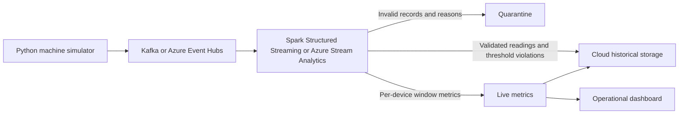

# Real-Time IoT Sensor Data Pipeline

A manufacturing operator needs to spot abnormal machine readings as they arrive. This project will simulate a fleet of machines, process their readings in near real time, and show which devices need attention. Historical readings will support later analysis.

**Project status** — Planning. The repository currently contains a manufacturing sensor CSV and an anomaly-detection notebook. The streaming components below are planned deliverables. Use the [implementation outline](PROJECT_OUTLINE.md) to track decisions, milestones, and demo criteria.

## Streaming architecture

The simulator will emit a device ID, an event timestamp, temperature, pressure, vibration, and machine status for each reading. The broker will let the simulator publish independently of the stream processor. The processor will validate each reading before applying threshold rules and calculating metrics over event-time windows.

A malformed reading should go to quarantine with a reason. A valid reading above an operating threshold should stay in the historical record with its device, timestamp, observed value, and violated rule. This distinction lets operators investigate machine conditions and lets developers investigate problems with the data feed.

## Operational view and demonstration

The dashboard will show the latest machine status and reading time per device, recent sensor trends, and threshold-violation counts. The Azure implementation calls for a real-time Power BI visualization. The broker, processor, cloud store, and dashboard serving method still need to be selected.

For the demo, run the simulator with normal readings, inject a temperature reading above the configured limit for one device, and send a separate record with a missing device ID. Verify that the operator can see the temperature violation, that the malformed record reaches quarantine, and that historical storage retains the valid readings after the live window closes.

## Existing project material

- [Manufacturing dataset](smart_manufacturing_data_dirty.csv) contains timestamped machine readings, machine status, and anomaly labels. Its machine identifier column is named `machine_id`.
- [Anomaly-detection notebook](anomaly-detection-using-ann.ipynb) is available for offline exploration. The streaming demo will use explicit threshold rules.

An optional extension will compare live windows with historical performance for the same machine using a warehouse.
